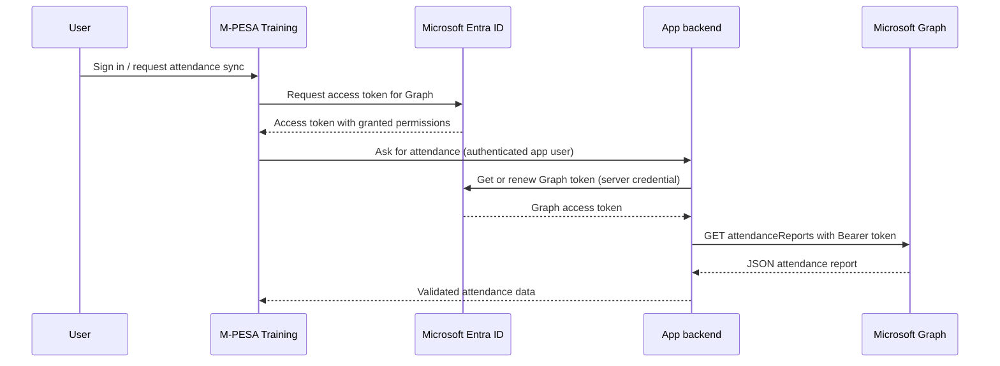

# Microsoft Graph API: concepts and setup for M-PESA Training

This guide explains Microsoft Graph, then walks through setting it up for this repository's Microsoft Teams attendance sync. The screenshots and portal labels can change; the linked Microsoft Learn pages are the source of truth for current portal steps.

Microsoft Learn references checked on **November 25, 2026**.

## 1. What Microsoft Graph is

Microsoft Graph is Microsoft's REST API for Microsoft 365 and Microsoft Entra data. A client sends an HTTPS request to `https://graph.microsoft.com`, includes an OAuth 2.0 bearer access token, and gets a JSON response. The URL identifies both the API version and resource, for example:

```text
GET https://graph.microsoft.com/v1.0/me/onlineMeetings/{meetingId}/attendanceReports
Authorization: Bearer <access-token>
```

- `v1.0` is the stable production API version. `/beta` can change and should not be used for production features unless you have explicitly accepted that risk.
- `/me` means the user represented by a **delegated** access token. `/users/{userId}` names the organizer whose meetings are being accessed, and is used for an **application** token.
- The access token tells Graph which identity is making the call and which permissions were granted. A client ID identifies an app; it is not an access token or a secret.
- Graph enforces the permissions and resource access policy on every request. Knowing a meeting ID by itself does not grant access.

Microsoft Graph API requests use the Microsoft identity platform for authentication and authorization. See [Microsoft Graph overview](https://learn.microsoft.com/graph/overview), [OAuth 2.0 authorization code flow](https://learn.microsoft.com/en-us/entra/identity-platform/v2-oauth2-auth-code-flow), and [Microsoft Graph permissions](https://learn.microsoft.com/graph/permissions-overview).

## 2. How sign-in and a Graph call fit together

An app registration in Microsoft Entra ID establishes trust between the app and Microsoft's identity platform. The app asks for permission, a user or administrator consents, and the identity platform issues a short-lived access token. The app sends that token in the `Authorization: Bearer ...` header to Graph. Graph validates the token, checks its audience and permissions, and either returns the requested data or an HTTP error.



An **ID token** tells the app who signed in. An **access token** is what authorizes a call to Graph. Do not send an ID token to Graph. Do not decode a token and treat that as validation; the API that receives it must validate it.

### Delegated permission or application permission?

| Permission type | Who the Graph call acts as | Typical use | Where a credential lives |
| --- | --- | --- | --- |
| Delegated | The signed-in work/school user, constrained by both their access and the app's scopes | An organizer signs in and syncs their own meeting | SPA uses MSAL; no client secret in the browser |
| Application | The app itself, without a signed-in Microsoft user | A trusted backend syncs for a known set of meeting organizers | Confidential credential stays on a server; admin consent and a Teams application access policy are required for meeting APIs |

For a browser-only React app, use authorization code with PKCE through MSAL. Never put a client secret or certificate in browser code, `VITE_*` variables, or a checked-in file. For an unattended or centrally managed sync, use a backend and application permissions, and scope it to specific organizers with an application access policy. Microsoft explains the distinction in [permission types](https://learn.microsoft.com/graph/permissions-overview#permission-types) and [application access policies for online meetings](https://learn.microsoft.com/graph/cloud-communication-online-meeting-application-access-policy).

## 3. What this repository already does

The current implementation is a **Teams attendance provider**, not a general-purpose Microsoft Graph client:

- [`src/admin/teams/attendance.ts`](../src/admin/teams/attendance.ts) has `graphProvider()`. It lists the meeting's attendance reports, selects a report, expands its `attendanceRecords`, and maps them into the app's attendance shape.
- It calls `GET /me/onlineMeetings/{meetingId}/attendanceReports` and `GET /me/onlineMeetings/{meetingId}/attendanceReports/{reportId}?$expand=attendanceRecords`.
- `graphProvider(baseUrl, getToken?)` can add a bearer token when a token callback is passed.
- `getAttendanceProvider()` currently passes the configured base URL **without** a token callback. The expected configuration is therefore a trusted backend proxy that adds/gets the Graph token server-side.
- `.env.example` documents `VITE_GRAPH_BASE_URL`; when it is unset, the app uses deterministic simulated attendance. Setting it only selects the Graph provider; it does not create an app registration, authenticate a user, grant permissions, or create a backend.
- The repository currently has no MSAL dependency and no Graph backend. Its learner/admin authentication is not Microsoft Graph authentication.
- The Teams attendance panel lets an admin link a Teams join URL and Graph `onlineMeeting` ID to a training. The ID is not the join URL. The current panel's meeting ID hint uses `GET /me/onlineMeetings?$filter=JoinWebUrl eq '{join link}'`.
- Attendance is summarized against the app's participant roster. A real Graph response can include people whose email is missing or does not match the roster; those records may not map to a roster row.

**Important:** Do not set `VITE_GRAPH_BASE_URL=https://graph.microsoft.com/v1.0` in this repository as-is. The current provider would send requests without an `Authorization` header. Configure it to a backend endpoint that authenticates the request and attaches the Graph access token, or first implement and pass a secure MSAL token callback.

## 4. Microsoft 365 and Entra prerequisites

Before changing code, make sure you have:

1. A Microsoft Entra workforce tenant and a Microsoft 365 tenant with Teams.
2. A real Teams meeting organized by the account that will be authorized to read its attendance report. The Graph meeting APIs in this guide do not support personal Microsoft accounts.
3. An Entra account with permission to register applications. An administrator may need to grant tenant-wide consent for the selected permissions.
4. A Teams administrator who can manage the meeting attendance report policy.
5. The backend hosting environment and secrets store for the app-only approach, or a decision to integrate delegated Microsoft sign-in into the SPA.

### Turn on the Teams attendance report

In the Teams admin center, open **Meetings → Meeting policies**, select the policy assigned to the organizer, and check **Attendance and engagement report**. Check **Include attendees in the report** and **Attendee information** too. If the policy disables reports, excludes attendees, or hides join/leave/duration details, Graph cannot return those details. The meeting organizer may also disable the report in the meeting options if the policy allows it. See [Manage the attendance and engagement report in Teams](https://learn.microsoft.com/microsoftteams/teams-analytics-and-reports/meeting-attendance-report).

## 5. Create an app registration

Use a dedicated registration for this integration. A single-tenant registration is the usual choice for an internal M-PESA Training deployment.

1. Open the [Microsoft Entra admin center](https://entra.microsoft.com/).
2. Go to **Identity → Applications → App registrations → New registration**.
3. Enter a clear name, such as `M-PESA Training Graph Attendance`.
4. Select **Accounts in this organizational directory only** unless the app is intentionally serving multiple tenants.
5. Register the app and record its **Application (client) ID** and **Directory (tenant) ID**. The object ID is different from the client ID; do not confuse the two.
6. Configure its platform according to the authentication option below.

Microsoft's current registration guide is [Register an application in Microsoft Entra ID](https://learn.microsoft.com/entra/identity-platform/quickstart-register-app).

### Option A: delegated sign-in from the React SPA

Choose this if a Microsoft work/school user will manually sync meetings they can access. It most directly matches the existing `/me/...` endpoint paths.

1. In the app registration, open **Authentication → Add a platform → Single-page application**.
2. Add the local Vite redirect URI `http://localhost:5173/` and the exact production app URL used for sign-in. A redirect URI must match exactly, including scheme, host, path, and trailing slash.
3. Use the authorization code flow with PKCE. Do not enable implicit access-token or ID-token issuance for a new SPA.
4. Under **API permissions → Add a permission → Microsoft Graph → Delegated permissions**, add:
   - `OnlineMeetingArtifact.Read.All` to read attendance reports and attendance records.
   - `OnlineMeetings.Read` if the app also needs to look up an online meeting from its join URL.
5. Ask your tenant admin to grant consent if your tenant requires admin approval. Although the delegated attendance permission is not marked as always requiring admin consent, organization consent policy can still require it.
6. In the React app, add `@azure/msal-browser` and `@azure/msal-react`, configure MSAL with the tenant ID, client ID, and registered redirect URI, and wrap the app with `MsalProvider`.
7. At sync time, request an access token for the Graph scopes using `acquireTokenSilent` first. If MSAL returns an interaction-required error, ask the user to sign in through a popup or redirect, then retry.
8. Pass the token into the provider as `getToken`; the current `getAttendanceProvider()` needs an integration change because it does not pass that callback today.

Minimal token-acquisition shape (illustrative; MSAL setup and error handling still need to be added):

```ts
const token = await msalInstance.acquireTokenSilent({
  account: msalInstance.getActiveAccount()!,
  scopes: ['OnlineMeetingArtifact.Read.All'],
})

const provider = graphProvider(
  'https://graph.microsoft.com/v1.0',
  async () => token.accessToken,
)
```

In real code, acquire the token inside the callback so it can be renewed when necessary; do not assume a token remains valid for the lifetime of the page. Use `OnlineMeetings.Read` as well if the app does meeting discovery. Follow Microsoft's [React SPA quickstart](https://learn.microsoft.com/entra/identity-platform/quickstart-single-page-app-sign-in) and [MSAL token acquisition guidance](https://learn.microsoft.com/entra/identity-platform/msal/javascript/browser/acquire-token).

**Limit:** delegated `/me` requests act as the signed-in organizer account. If a training manager signs in with a different account, they may not be able to read another organizer's report. A delegated token is not a way to bypass the organizer's access.

### Option B: application access from a backend (recommended for centralized service sync)

Choose this if the portal should sync for known organizers without asking each organizer to sign in to Microsoft. Graph calls and app credentials must stay on the backend.

1. Use a confidential backend app registration (a separate registration keeps its broader permissions separate from the browser client).
2. In **API permissions → Add a permission → Microsoft Graph → Application permissions**, add:
   - `OnlineMeetingArtifact.Read.All` to read the attendance reports.
   - `OnlineMeetings.Read.All` only if the backend must find the meeting from a join URL or read meeting details.
3. Select **Grant admin consent for [tenant]**. Application permissions require admin consent.
4. Under **Certificates & secrets**, create a credential for the backend. Prefer a certificate or the hosting platform's managed identity/federated credential where supported. If using a client secret, keep it in the deployment secret store, rotate it, and never expose it to the browser.
5. Configure a Teams application access policy for only the organizer account(s) the service is allowed to access. Connect to Skype for Business Online PowerShell as an authorized admin and run commands like these with your real values:

```powershell
Connect-MicrosoftTeams

New-CsApplicationAccessPolicy `
  -Identity "MPesaTrainingAttendance" `
  -AppIds "<BACKEND-APPLICATION-CLIENT-ID>" `
  -Description "Allow the M-PESA Training service to read attendance for approved organizers"

Grant-CsApplicationAccessPolicy `
  -PolicyName "MPesaTrainingAttendance" `
  -Identity "<ORGANIZER-ENTRA-USER-OBJECT-ID>"
```

Do not grant this policy globally unless the service is intentionally authorized for every user. Microsoft notes policy changes may take up to 30 minutes to take effect. The policy controls which organizer's online meetings the app can access; it is not a substitute for granting Graph application permissions. See [Configure application access to online meetings](https://learn.microsoft.com/graph/cloud-communication-online-meeting-application-access-policy).

6. In the backend, use the OAuth client-credentials flow to get an app-only token for `https://graph.microsoft.com/.default`. `/.default` requests the Graph application permissions already configured and consented on the app registration; it is not a permission by itself.
7. Call Graph from the backend with that token. Application tokens must use `/users/{organizerObjectId}/...`, not `/me/...`.
8. Add an authenticated, role-checked application endpoint for the frontend. It should accept an internal training ID, load the linked Graph meeting ID and organizer ID from trusted server-side data, call Graph, validate/map the response, and return only the data the user is authorized to see.
9. Configure the frontend to call that backend endpoint. `VITE_GRAPH_BASE_URL` is public frontend configuration; it may contain a backend URL, never a client secret or private key.

Backend token acquisition outline (server-side only; add `@azure/msal-node` to the backend project, not this Vite browser bundle):

```ts
const result = await confidentialClient.acquireTokenByClientCredential({
  scopes: ['https://graph.microsoft.com/.default'],
})

if (!result?.accessToken) throw new Error('Could not obtain Microsoft Graph token')

const response = await fetch(
  `https://graph.microsoft.com/v1.0/users/${organizerObjectId}/onlineMeetings/${encodeURIComponent(meetingId)}/attendanceReports`,
  { headers: { Authorization: `Bearer ${result.accessToken}`, Accept: 'application/json' } },
)
```

This is an outline, not a complete production backend. The backend still needs to authenticate the portal user, authorize access to the training, validate IDs, handle Graph errors, and avoid becoming an unrestricted Graph proxy. For app-only permissions, change the current `/me` paths or have the backend map an internal, trusted request to `/users/{organizerObjectId}`. Do not accept an arbitrary Graph URL from the browser.

## 6. Find and link the Teams meeting

The API needs the Graph `onlineMeeting.id`, which differs from the join URL and from a meeting's human-readable ID. For a delegated organizer, meeting discovery can use:

```http
GET https://graph.microsoft.com/v1.0/me/onlineMeetings?$filter=JoinWebUrl eq '{joinWebUrl}'
Authorization: Bearer <access-token>
```

For an application token, use the organizer path:

```http
GET https://graph.microsoft.com/v1.0/users/{organizerObjectId}/onlineMeetings?$filter=JoinWebUrl eq '{joinWebUrl}'
Authorization: Bearer <access-token>
```

Encode the filter as a URL query parameter in code (for example with `URLSearchParams`) rather than concatenating user-provided text into the URL. Meeting discovery requires meeting-read permission: delegated `OnlineMeetings.Read`, or application `OnlineMeetings.Read.All` plus the application access policy. Use the returned `id` value in the training record. In the current app, open the training's Teams meeting dialog and save both the real Teams join link and this Graph ID; replace demo meeting values.

## 7. How the attendance requests work

After a meeting occurrence ends, Graph generates an attendance report for that session, subject to Teams policy and report availability. A recurring meeting can have multiple reports under one `onlineMeeting` ID.

### Request 1: list reports

Delegated organizer token:

```http
GET https://graph.microsoft.com/v1.0/me/onlineMeetings/{meetingId}/attendanceReports
Authorization: Bearer <access-token>
```

Application token:

```http
GET https://graph.microsoft.com/v1.0/users/{organizerObjectId}/onlineMeetings/{meetingId}/attendanceReports
Authorization: Bearer <access-token>
```

The response's `value` array contains report IDs and start/end timestamps. The list API returns up to the 50 most recent reports.

### Request 2: get participant records

```http
GET https://graph.microsoft.com/v1.0/me/onlineMeetings/{meetingId}/attendanceReports/{reportId}?$expand=attendanceRecords
Authorization: Bearer <access-token>
```

For app-only authentication, replace `/me` with `/users/{organizerObjectId}`. The list response does not include participant records by default; `$expand=attendanceRecords` retrieves them inline. Alternatively, call the separate `attendanceRecords` endpoint. See [List attendance reports](https://learn.microsoft.com/graph/api/meetingattendancereport-list?view=graph-rest-1.0), [Get an attendance report](https://learn.microsoft.com/graph/api/meetingattendancereport-get?view=graph-rest-1.0), and [List attendance records](https://learn.microsoft.com/graph/api/attendancerecord-list?view=graph-rest-1.0).

An attendance record can contain an email address, role, total time in seconds, identity, and one or more join/leave intervals. A person who leaves and rejoins may have several intervals. Anonymous participants or tenant privacy settings may omit identifying details.

### How the app turns Graph data into attendance rows

The app's `classify()` uses the configured training start/end times and attendance rules. Current defaults are:

- **Absent**: no attendance record, or less than 30% of the scheduled session.
- **Late**: joined more than 15 minutes after the scheduled start (provided they are not already classified absent).
- **Present**: attended at least 80% and was not late.
- **Incomplete**: attended enough to avoid absent, but did not meet the present rule.

These thresholds are editable under the Attendance rules dialog. Classification is app logic, not a Microsoft Graph status. Graph reports participation intervals; the app applies its own rules to those intervals and the training roster.

## 8. Configure this project

### Backend proxy configuration

The current provider appends the Graph path to `VITE_GRAPH_BASE_URL`, so the base must be the backend route prefix designed to accept those requests. For local development, for example:

```dotenv
VITE_GRAPH_BASE_URL=http://localhost:3001/graph/v1.0
```

Create a local `.env.local` in the repository root (it is ignored by Git), configure your backend on the same machine, and restart Vite after changing the environment file. Adapt the URL to the actual route your backend implements. The current project has no server listening on port 3001; the example is a placeholder, not a working endpoint.

The frontend currently emits paths beginning with `/me/onlineMeetings/...`. For a delegated proxy, pass them through after validating the signed-in user. For app-only authentication, update the integration so the server selects `/users/{organizerObjectId}/...` from trusted training data. The backend should not blindly proxy arbitrary paths or tokens.

### Frontend delegated configuration

If you choose direct SPA authentication instead, add the MSAL dependencies and implement MSAL initialization/provider wiring and a token callback. No MSAL env keys are currently read by the source. A frontend `VITE_ENTRA_CLIENT_ID` and `VITE_ENTRA_TENANT_ID` can be added after implementing that configuration; those IDs are public identifiers. Do not add `VITE_CLIENT_SECRET`, `VITE_GRAPH_SECRET`, or any private credential.

### Store the organizer identity

For application permissions, Graph needs the organizer's Entra **user object ID** in the `/users/{userId}` route. The current `TeamsMeeting` type stores only `joinUrl` and `meetingId`. Add an `organizerObjectId` to the trusted server-side meeting metadata (or establish one configured organizer) before app-only sync can work reliably. Do not infer the organizer from untrusted client form data.

## 9. Verify setup from end to end

Use a real, non-demo Teams meeting created by an authorized organizer.

1. Confirm that the organizer has the intended Teams meeting policy and attendance reporting is enabled.
2. Confirm the Entra registration has the correct Graph permission type and that required consent is granted.
3. For application access, confirm the app access policy contains the backend app client ID and is granted to the organizer's Entra user object ID. Wait for policy changes to propagate.
4. Sign in to the portal and link the real Graph meeting ID and join link to a training.
5. After the meeting ends, trigger **Sync from Teams**. A meeting in progress may not yet have a final attendance report. If no report exists, sync returns zero rows until a report is available.
6. Confirm the panel shows **Microsoft Graph** as its source, compare attendee intervals and durations with the Teams attendance report, and check that the app matched the expected roster.
7. Check browser/server logs for the Graph HTTP status and `request-id` on failure. Never log access tokens or secrets.

## 10. Troubleshooting

| Symptom | Likely cause | What to check |
| --- | --- | --- |
| `401 Unauthorized` | Missing, expired, malformed, or wrong-audience access token | Ensure a Graph access token is sent as `Authorization: Bearer ...`; don't send an ID token. Renew through MSAL or the backend credential flow. |
| `403 Forbidden` / `Authorization_RequestDenied` | Missing Graph permission, missing consent, wrong token type, or organizer not authorized | Inspect the permission type and admin consent. For application permissions, verify the app access policy and `/users/{organizerObjectId}` route. |
| `403` says “No application access policy found for this app” | Application permission is present but the Teams application access policy is absent, assigned to the wrong user, or has not propagated | Verify app client ID, policy grant target user object ID, and wait up to 30 minutes. |
| `404 Not Found` | Wrong meeting ID, report ID, organizer, or route | The meeting ID must be the Graph `onlineMeeting.id`, not its URL. Make sure delegated `/me` and app `/users/{id}` paths are not mixed. |
| Empty `value` array | Meeting has not ended, report not generated, wrong meeting occurrence, or report policy disabled | Check the meeting date, organizer's attendance policy, and whether Teams itself shows the report. |
| Attendees appear without names or join times | Attendee privacy choices or the Teams policy omits details | Check **Include attendees in the report** and **Attendee information** policy settings. Graph cannot restore omitted data. |
| `VITE_GRAPH_BASE_URL` set but request is unauthorized | The environment variable only changes the provider; no token is currently injected by `getAttendanceProvider()` | Point it at a working proxy that adds a valid token, or implement and pass an MSAL token callback. |
| `429 Too Many Requests` | Graph throttled the client | Honor the response's `Retry-After` header; do not immediately retry. See [Graph throttling guidance](https://learn.microsoft.com/graph/throttling). |
| Meeting sync uses a report from a different date | Recurring meeting report selection did not match the scheduled date | Current code compares the report's timestamp string prefix with `training.date` and falls back to the first report. In production, compare parsed timestamps against the training's timezone-aware interval and do not silently fall back to another occurrence. |

Graph error responses include a code/message and request identifiers. Save the request ID and UTC time for diagnostics, but redact access tokens, attendee data, and secrets from support logs. See [Microsoft Graph error responses](https://learn.microsoft.com/graph/errors).

## 11. Security and operational checklist

- Use only the minimum permissions the selected feature needs.
- Keep application credentials on the server; prefer certificates or managed identity when available, and rotate/revoke credentials if exposed.
- Protect the backend route with the portal's own authentication and role checks. Graph permission does not authorize every portal user to view every attendance report.
- Bind the backend request to a known training and organizer. Do not expose a generic Graph URL proxy.
- Use HTTPS outside localhost and restrict CORS to the deployed portal origin.
- Store only attendance fields the product needs. Treat names, emails, and attendance timestamps as personal data and follow the organization's retention/access policy.
- Handle `429` and transient `5xx` errors with bounded retries and `Retry-After`/backoff. Do not retry permission errors automatically.
- Use `/v1.0` for production and periodically check Microsoft Graph change notifications and API reference updates.
- Review the Graph permissions in Entra regularly and revoke consent for permissions the application no longer uses.

## 12. Microsoft references

- [Microsoft Graph overview](https://learn.microsoft.com/graph/overview)
- [Microsoft Graph permissions overview](https://learn.microsoft.com/graph/permissions-overview)
- [Register an app in Microsoft Entra ID](https://learn.microsoft.com/entra/identity-platform/quickstart-register-app)
- [Add a redirect URI](https://learn.microsoft.com/entra/identity-platform/how-to-add-redirect-uri)
- [React SPA sign-in and Graph quickstart](https://learn.microsoft.com/entra/identity-platform/quickstart-single-page-app-sign-in)
- [MSAL Browser token acquisition](https://learn.microsoft.com/entra/identity-platform/msal/javascript/browser/acquire-token)
- [Online meeting artifact permissions](https://learn.microsoft.com/graph/cloud-communications-online-meeting-artifacts)
- [List attendance reports](https://learn.microsoft.com/graph/api/meetingattendancereport-list?view=graph-rest-1.0)
- [Get an attendance report](https://learn.microsoft.com/graph/api/meetingattendancereport-get?view=graph-rest-1.0)
- [List attendance records](https://learn.microsoft.com/graph/api/attendancerecord-list?view=graph-rest-1.0)
- [Online meeting application access policy](https://learn.microsoft.com/graph/cloud-communication-online-meeting-application-access-policy)
- [Teams attendance report settings](https://learn.microsoft.com/microsoftteams/teams-analytics-and-reports/meeting-attendance-report)
- [Graph throttling guidance](https://learn.microsoft.com/graph/throttling)

